# 数据库 ER 图

本文档基于 `db/001_init_mysql.sql` 和 `backend/domain/models.py` 整理。图表采用 Mermaid ER 语法，可直接在支持 Mermaid 的 Markdown 环境中渲染。

```mermaid
erDiagram
    SYS_USER ||--o{ SYS_USER_ROLE : has
    SYS_ROLE ||--o{ SYS_USER_ROLE : grants
    SYS_USER ||--o{ SYS_AUTH_TOKEN : owns
    SYS_USER ||--o{ SYS_LOGIN_LOG : logs
    SYS_USER ||--o| EDU_TEACHER : binds
    SYS_USER ||--o{ MONITOR_SESSION : operates
    SYS_USER ||--o{ MONITOR_BEHAVIOR_EVENT : handles

    EDU_TEACHER ||--o{ EDU_CLASS : manages
    EDU_TEACHER ||--o{ EDU_TEACHER_CLASS : teaches
    EDU_CLASS ||--o{ EDU_TEACHER_CLASS : authorizes
    EDU_SUBJECT ||--o{ EDU_TEACHER_CLASS : scopes

    EDU_CLASS ||--o{ MONITOR_SESSION : records
    EDU_TEACHER ||--o{ MONITOR_SESSION : teaches
    EDU_SUBJECT ||--o{ MONITOR_SESSION : belongs_to
    MONITOR_SESSION ||--o{ MONITOR_SESSION_SEAT : contains
    MONITOR_SESSION ||--o{ MONITOR_BEHAVIOR_EVENT : produces
    EDU_CLASS ||--o{ MONITOR_BEHAVIOR_EVENT : occurs_in
    MONITOR_SESSION_SEAT ||--o{ MONITOR_BEHAVIOR_EVENT : locates
    MONITOR_BEHAVIOR_EVENT ||--o{ MONITOR_EVENT_FRAME : has
    MONITOR_BEHAVIOR_EVENT ||--o{ MONITOR_VLM_REVIEW : reviewed_by
    MONITOR_SESSION ||--o{ MONITOR_VLM_REVIEW : includes
    MONITOR_SESSION_SEAT ||--o{ MONITOR_VLM_REVIEW : reviews
    MONITOR_SESSION ||--o{ MONITOR_TEACHING_REVIEW : summarized_by
    EDU_TEACHER ||--o{ MONITOR_TEACHING_REVIEW : writes

    SYS_USER {
        BIGINT id PK
        VARCHAR username UK
        VARCHAR password_hash
        VARCHAR real_name
        VARCHAR status
        INT failed_login_count
        DATETIME last_login_at
        DATETIME created_at
        DATETIME updated_at
    }

    SYS_ROLE {
        BIGINT id PK
        VARCHAR role_code UK
        VARCHAR role_name
        VARCHAR description
        TINYINT enabled
        DATETIME created_at
        DATETIME updated_at
    }

    SYS_USER_ROLE {
        BIGINT id PK
        BIGINT user_id FK
        BIGINT role_id FK
        DATETIME created_at
    }

    SYS_AUTH_TOKEN {
        BIGINT id PK
        BIGINT user_id FK
        VARCHAR token_jti UK
        VARCHAR refresh_token_hash
        DATETIME expires_at
        DATETIME revoked_at
        DATETIME created_at
    }

    SYS_LOGIN_LOG {
        BIGINT id PK
        BIGINT user_id FK
        VARCHAR username
        VARCHAR login_result
        VARCHAR fail_reason
        VARCHAR client_ip
        DATETIME created_at
    }

    EDU_TEACHER {
        BIGINT id PK
        BIGINT user_id FK
        VARCHAR teacher_no UK
        VARCHAR teacher_name
        VARCHAR department
        VARCHAR title
        VARCHAR status
        DATETIME created_at
        DATETIME updated_at
    }

    EDU_CLASS {
        BIGINT id PK
        VARCHAR class_code UK
        VARCHAR class_name
        VARCHAR grade_name
        VARCHAR academic_year
        BIGINT head_teacher_id FK
        VARCHAR default_video_path
        TINYINT enabled
    }

    EDU_SUBJECT {
        BIGINT id PK
        VARCHAR subject_code UK
        VARCHAR subject_name
        TINYINT enabled
    }

    EDU_TEACHER_CLASS {
        BIGINT id PK
        BIGINT teacher_id FK
        BIGINT class_id FK
        BIGINT subject_id FK
        VARCHAR relation_type
        TINYINT can_view_monitor
        TINYINT can_start_monitor
        TINYINT can_review
        TINYINT enabled
    }

    MONITOR_SESSION {
        BIGINT id PK
        VARCHAR session_no UK
        BIGINT class_id FK
        VARCHAR class_name
        BIGINT teacher_id FK
        BIGINT subject_id FK
        BIGINT operator_user_id FK
        VARCHAR status
        DATETIME started_at
        DATETIME ended_at
        INT event_count
    }

    MONITOR_SESSION_SEAT {
        BIGINT id PK
        BIGINT session_id FK
        INT runtime_seat_id
        VARCHAR seat_code
        DECIMAL box_x1
        DECIMAL box_y1
        DECIMAL box_x2
        DECIMAL box_y2
        VARCHAR status
        INT det_category
    }

    MONITOR_BEHAVIOR_EVENT {
        BIGINT id PK
        VARCHAR event_uid UK
        BIGINT session_id FK
        BIGINT class_id FK
        BIGINT seat_id FK
        VARCHAR seat_code
        VARCHAR level
        VARCHAR status
        VARCHAR label
        DATETIME event_time
        VARCHAR handle_status
    }

    MONITOR_EVENT_FRAME {
        BIGINT id PK
        BIGINT event_id FK
        INT frame_index
        DATETIME frame_time
        VARCHAR focus_image_url
        VARCHAR seat_code
        VARCHAR status
        JSON raw_payload_json
    }

    MONITOR_VLM_REVIEW {
        BIGINT id PK
        BIGINT event_id FK
        BIGINT session_id FK
        BIGINT seat_id FK
        VARCHAR model_name
        LONGTEXT raw_response
        VARCHAR parsed_status
        VARCHAR parsed_label
        TINYINT success
        INT latency_ms
    }

    MONITOR_TEACHING_REVIEW {
        BIGINT id PK
        BIGINT session_id FK
        BIGINT teacher_id FK
        VARCHAR review_status
        DECIMAL teaching_effect_score
        TEXT focus_summary
        TEXT problem_summary
        TEXT improvement_plan
        DATETIME reviewed_at
    }
```

## 表分组说明

- 系统权限表：`sys_user`、`sys_role`、`sys_user_role`、`sys_auth_token`、`sys_login_log`。
- 教学基础数据表：`edu_teacher`、`edu_class`、`edu_subject`、`edu_teacher_class`。
- 监控业务表：`monitor_session`、`monitor_session_seat`、`monitor_behavior_event`、`monitor_event_frame`、`monitor_vlm_review`、`monitor_teaching_review`。

