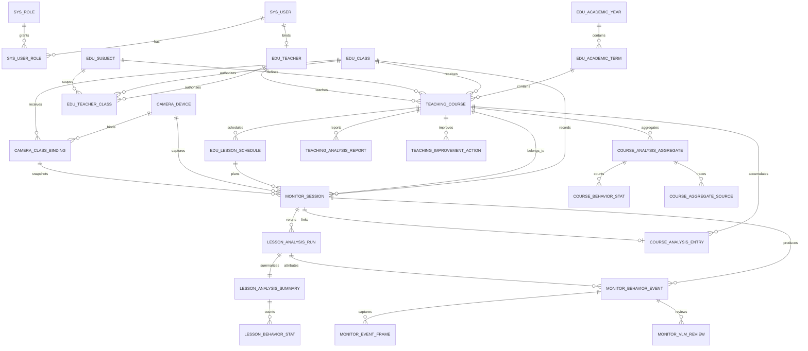

# 课后教学分析数据库 ER 图

本文档基于 `db/001_init_mysql.sql`、`db/002_teaching_analysis.sql` 与 `backend/domain/models.py` 整理。`002` 是已有数据库的增量脚本；首次部署需先执行 `001`，再执行 `002`。

## 核心实体与职责

| 分组 | 核心表 | 作用 |
| --- | --- | --- |
| 教学主数据 | `edu_academic_year`、`edu_academic_term`、`teaching_course` | 定义学年、学期、班级—科目课程与任课教师。`teacher_id` 可在课表维护完成后补充。 |
| 固定排课与采集归属 | `edu_lesson_schedule`、`camera_device`、`camera_class_binding` | 用七天、上午四节和下午三节的固定课表描述课次；摄像设备按班级和有效日期绑定。 |
| 课次与证据 | `monitor_session`、`monitor_session_seat`、`monitor_behavior_event`、`monitor_event_frame`、`monitor_vlm_review` | 保存一次课次、座位状态、行为事件、截图帧与 VLM 复核证据。课次保存课程、课表与摄像头绑定快照。 |
| 分析版本 | `lesson_analysis_run`、`lesson_analysis_summary`、`lesson_behavior_stat` | 支持同一课次的可追溯重跑，只有标记为当前且已完成的分析版本进入课程聚合。 |
| 课程复盘 | `course_analysis_entry`、`course_analysis_aggregate`、`course_behavior_stat`、`course_aggregate_source`、`teaching_analysis_report`、`teaching_improvement_action` | 将课次材料串联到课程维度，支持周期汇总、报告草稿、教师结论与改进闭环。 |
| 权限与账号 | `sys_user`、`sys_role`、`sys_user_role`、`edu_teacher`、`edu_teacher_class` | 区分管理员和教师；课程级报告由教学课程任课教师控制，班级级历史查看由班级授权控制。 |

## 关键一致性约束

- 一个 `teaching_course` 对应一个班级、一个学期和一个科目；当前业务默认一位教师通常教授一门科目，但模型允许教师存在多条教学课程。
- 同一教学课程在同一星期和开始时间只能有一条固定课表记录。
- 同一摄像设备在有效日期内不得为两个班级建立重叠绑定。
- 课程分析条目通过 `teaching_course_id` 过滤，防止同班不同课程的课次、报告和改进措施混合。
- 行为事件、课次汇总和课程聚合均保存分析运行标识或来源关系，以便复查和重算。
