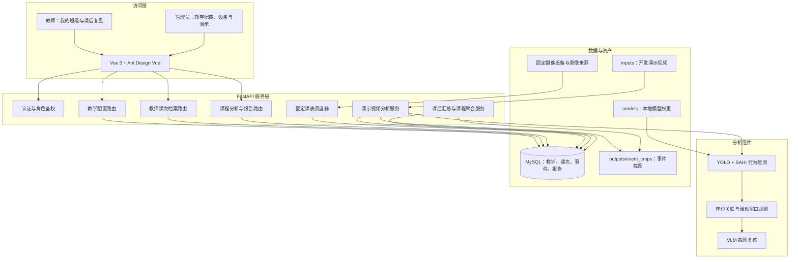
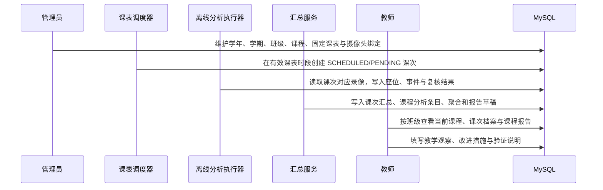

# 课后教学分析系统架构

## 设计定位

系统服务于教师的课后教学复盘。课堂行为识别结果先作为可复查的事件证据保存，再按课次、课程和学期整理为汇总与报告；系统不把实时告警作为教师授课过程中的常规操作入口。

管理员维护教学基础数据、固定周课表、摄像设备与班级有效期绑定。教师从“我的班级”进入自己任教课程的课次档案、课程分析和改进闭环。实时视频页面仅保留为管理员验证检测链路的开发演示入口。

## 总体架构

## 课表到课程报告的数据链路

其中，固定课表调度、教学课程权限、课次档案和课程报告的数据关系已实现；真实录像离线分析执行器仍需在接入受控录像源后实现。开发演示分析结束时可以调用相同的汇总服务生成课后资料，但不等同于真实课堂录像的端到端验证。

## 权限与数据边界

- 管理员拥有教学配置、设备绑定、账号与班级授权、全局课次档案和演示分析入口。
- 教师的“我的班级”根据 `teaching_course.teacher_id` 聚合；当前课程按当前本地时间、有效学期和固定课表匹配。
- 课程报告、课程分析条目和按课程筛选的课次档案以教学课程为权限边界；同班不同课程的记录不会混入。
- 班级授权可用于查看班级级课次档案；教学课程分析还要求课程已分配给该教师。

## 当前验证范围与限制

- 已验证：路由注册、角色鉴权主路径、课表与课程管理接口、课程分析接口、前端构建、现有自动化测试和运行中 API 冒烟检查。
- 待验证：真实摄像机或录播视频的离线处理器、模型与 VLM 的真实端到端调用、长时间运行、多课堂并发、权限矩阵的端到端回归。
- 已知复核项：课表调度器的“已结束课次”状态转换缺少专门自动化测试；当前代码的事务边界需要在后续修复后再做专项验证，不能将其视为已完成的离线处理闭环。
